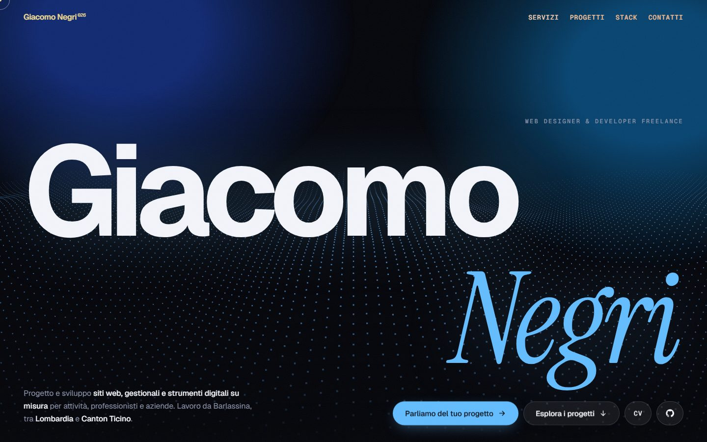

# MyPortfolio

The source of [giacomonegri.vercel.app](https://giacomonegri.vercel.app), the portfolio of Giacomo Negri, developer.

It is a static site written by hand in HTML, CSS and JavaScript: no framework, no build step, no template. The site has two jobs: showing shops, professionals and local businesses that I build custom websites, and letting recruiters and developers look at real projects and at the code behind them, starting with this one.



## What is on the page

| Section | Purpose |
| --- | --- |
| Hero | Who I am, what I build, and the two main paths: ask for a website or explore the work |
| Siti web | Custom websites for businesses, landing pages and restyling, described for people who do not know the technical side; software on request is mentioned as a side note |
| Chi sono | A short, factual introduction |
| Progetti | Four case studies (problem, solution, technique) with real screenshots, live demos and links to the code |
| Esperienza | The internship in industrial electronics, with a simulated serial monitor |
| Stack | Technologies I have actually used in the projects, and how I work |
| Formazione | School and planned certifications |
| Contatti | Email and quote request for clients; GitHub, LinkedIn, CV and this repository for recruiters |

## Built with

| What | Why |
| --- | --- |
| HTML, CSS, JavaScript (no build) | A single page does not need a framework; the browser runs the files as they are |
| [GSAP](https://gsap.com) 3.12 + ScrollTrigger | Intro animation, scroll reveals, horizontal projects section |
| [Three.js](https://threejs.org) r128 | The particle wave in the hero, computed on the GPU by a small vertex shader |
| [Lenis](https://github.com/darkroomengineering/lenis) 1.1 | Smooth scrolling |
| Local fonts (`assets/fonts/`) | Geist, Geist Mono and Instrument Serif, served from this site as WOFF2 (SIL Open Font License), latin and latin-ext subsets only |
| [Vercel](https://vercel.com) | Hosting; every push to `main` goes live |

The fonts come from the site itself; the four libraries load from public CDNs with [Subresource Integrity](https://developer.mozilla.org/docs/Web/Security/Subresource_Integrity) hashes. There is no `package.json` because nothing has to be installed.

## Run it locally

```bash
git clone https://github.com/jacknegri89/MyPortfolio.git
cd MyPortfolio
python -m http.server 5173
```

Then open http://localhost:5173. Opening `index.html` with a double click works too. An internet connection is needed for the CDN libraries; without them the page still shows all its content, only without animations.

## Structure

```
index.html            the whole page: content only (texts, sections, links)
privacy.html          privacy and cookie notice
404.html              "page not found"
css/                  one stylesheet per part of the page
js/
  core/               base classes used across the site
  components/         one class per interactive element
  animations/         GSAP animations (intro, scroll, horizontal projects)
  App.js              creates and starts every component, in order
  main.js             starts App (must be the last script)
assets/
  projects/           real screenshots, one folder per project
  og.jpg              preview image shown when the link is shared
  fonts/              WOFF2 files, declared in css/fonts.css
  CV-Giacomo-Negri.pdf
docs/                 images used by this README (not deployed)
vercel.json           clean URLs, caching and security headers
```

### JavaScript

Plain classes, one per file, named like the file. Each has a `start()` (or `play()`) method, and `App.js` is the only place that creates them, so the start-up order can be read from top to bottom in one file. The scripts are ordinary `<script>` tags rather than modules, which keeps the site working when the file is opened directly from disk; for the same reason their order in `index.html` matters.

| Class | What it does |
| --- | --- |
| `Environment` | Reads once whether the visitor uses a mouse, prefers reduced motion, and whether GSAP loaded |
| `SmoothScroll` | Lenis scrolling, scroll speed for the marquee, in-page `#` links |
| `TextSplitter` | Splits a text into words or letters to animate |
| `OffscreenPauser` | Pauses endless CSS animations in sections that are off screen |
| `ParticleWave` | The 3D particle wave in the hero |
| `CustomCursor`, `CardSpotlight`, `MagneticButtons` | Mouse effects, desktop only |
| `ScreenshotTabs` | Switches between the screenshots of a project |
| `ScraperTerminal`, `InViewWatcher` | The typed terminal in the JobScraper card, started when it becomes visible |
| `SecureNotesDemo`, `SerialMonitor` | Small simulations (encrypted notes, Raspberry Pi control loop) |
| `CopyButtons` | Copies the email address |
| `VelocityMarquee` | Text bands that follow the scroll speed |
| `IntroAnimation`, `ScrollAnimations`, `HorizontalProjects`, `FooterSignature` | The GSAP animations |

### CSS

One file per section, loaded in a fixed order: `base.css` first (colour and font variables, reset, shared helpers), `reduced-motion.css` last. Colours are CSS variables in `:root`, so the accent colour changes in one place.

### Animations

- Animations run only when GSAP has loaded and the visitor has not asked for reduced motion (`Environment.canAnimateWithGsap()`). Otherwise the loader is hidden at once and the full content is visible.
- On screens at least 1000 px wide and 680 px tall, the projects section is pinned and scrolls horizontally; below that the projects are stacked. `ScrollTrigger.matchMedia` switches between the two when the window is resized.
- Keyboard users are not left behind by the horizontal section: when a link inside a project receives focus, the page scrolls to that project.

### Responsive layout and accessibility

- Checked at 320, 375, 768, 1000, 1280 and 1440 px wide, with no horizontal scrolling.
- One `<h1>`, semantic sections, a "skip to content" link, visible keyboard focus, `alt` text and explicit sizes on every image.
- The screenshot switcher uses real `<button>` elements with `aria-pressed`.
- The one scrollable region (the system diagram in the experience section) can be focused and scrolled with the keyboard and has an accessible name.
- `prefers-reduced-motion` is respected by both the CSS and the JavaScript.

### Screenshots of the projects

Every screenshot in `assets/projects/` shows the real application; none is a mock-up.

| Project | Source |
| --- | --- |
| JobScraper | `docs/dashboard-dark.png` and `docs/panel.png` from its repository, generated by the project from invented sample listings |
| LogLens | Home page captured from the live demo; report and Workbench from `docs/screenshots/` in its repository |
| Renova | Public pages captured from the live site |
| Secure Notes | No screenshot: the phone in the card is a reconstruction of the interface and is labelled as such |

They are stored as 1280×800 WebP files, lazy-loaded, with declared dimensions.

## Security

- A Content-Security-Policy in each page allows scripts only from this site and the two CDNs, and fonts and images only from this site; inline scripts are not allowed.
- CDN scripts carry SRI hashes, so a tampered file is refused by the browser.
- `vercel.json` adds `X-Content-Type-Options`, `Referrer-Policy`, `X-Frame-Options` and `Permissions-Policy`.
- The site has no forms, no cookies and no analytics. Contact goes through a `mailto:` link.
- No secrets exist in this repository: there is no backend and nothing to configure.

## Checks

There is no test suite to install. Before publishing I run:

```bash
# JavaScript syntax
for f in js/*.js js/*/*.js; do node --check "$f"; done
```

and open the page in a real browser (Chromium through Playwright) at the widths listed above, checking the console for errors, horizontal overflow, the screenshot buttons, keyboard navigation in the projects section, the page with the CDNs blocked, and reduced motion. [axe-core](https://github.com/dequelabs/axe-core) (WCAG 2.x A/AA and best-practice rules) is run on the three pages at phone and desktop width; the scripts live outside the repository.

## Common tasks

- **After changing CSS or JS:** replace the version after `?v=` everywhere in the HTML files (for example `?v=2026-11-10b` → `?v=2026-11-11a`). CSS and JS are cached for a month, and the version is what makes returning visitors download the new files.
- **Adding a project:** copy an `<article class="card proj">` block in `index.html`. The horizontal scrolling adapts on its own. Put its screenshots in `assets/projects/<name>/` as 1280×800 WebP.
- **Adding an effect:** create the class in `js/components/`, add its `<script>` before `App.js`, and start it inside `App.start()`.
- **Adding an external script, style or font:** add its domain to the Content-Security-Policy in the `<head>`, and an SRI hash to the tag.

## Deployment

Vercel is connected to this repository: every push to `main` publishes the site, usually within a minute. `.vercelignore` keeps the README and `docs/` out of the deployment.

## License

No open-source license is granted. The code is public so that it can be read and evaluated; the texts, the design and the images remain the property of Giacomo Negri. The libraries listed above keep their own licenses, and the fonts are under the SIL Open Font License (texts in `assets/fonts/OFL-*.txt`).

---

Made by [Giacomo Negri](https://www.linkedin.com/in/giacomo-negri-952084448) · [giacomonegri.vercel.app](https://giacomonegri.vercel.app)
