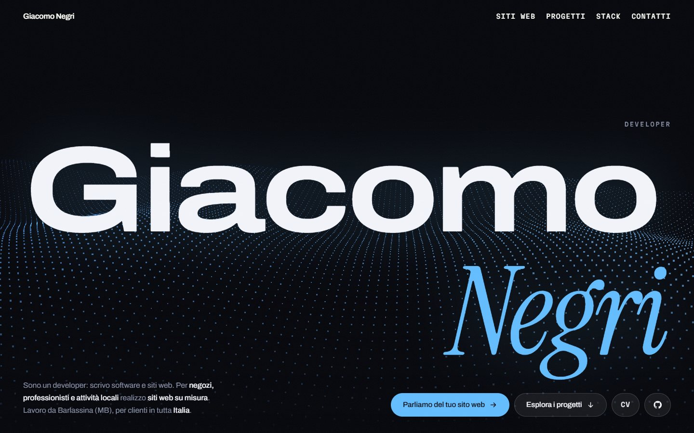

# MyPortfolio

The source of [giacomonegri.vercel.app](https://giacomonegri.vercel.app), the portfolio of Giacomo Negri, developer.

It is a static site written by hand in HTML, CSS and JavaScript: no framework, no build step, no template. The site has two jobs: showing shops, professionals and local businesses that I build custom websites, and letting recruiters and developers look at real projects and at the code behind them, starting with this one.



## What is on the page

| Section | Purpose |
| --- | --- |
| Hero | Who I am, what I build, and the two main paths: ask for a website or explore the work |
| Siti web | Custom websites for businesses, landing pages and restyling, described for people who do not know the technical side; software on request is mentioned as a side note |
| Chi sono | A short, factual introduction |
| Progetti | Four case studies (problem, solution, technique) with real screenshots, live demos and links to the code |
| Esperienza | The internship in industrial electronics, with a simulated serial monitor |
| Stack | Technologies I have actually used in the projects, and how I work |
| Formazione | School and planned certifications |
| Contatti | Email and quote request for clients; GitHub, LinkedIn, CV and this repository for recruiters |

## Built with

| What | Why |
| --- | --- |
| HTML, CSS, JavaScript (no build) | A single page does not need a framework; the browser runs the files as they are |
| [GSAP](https://gsap.com) 3.14 + ScrollTrigger | Intro animation, scroll reveals, horizontal projects section |
| GSAP plugins: SplitText, ScrambleText, DrawSVG | Paragraphs revealed line by line, labels that decode, the system diagram drawing itself |
| [Three.js](https://threejs.org) r128 | The particle wave in the hero, computed on the GPU by a small vertex shader |
| [Lenis](https://github.com/darkroomengineering/lenis) 1.1 | Smooth scrolling |
| Local fonts (`assets/fonts/`) | Geist, Geist Mono and Instrument Serif, served from this site as WOFF2 (SIL Open Font License), latin and latin-ext subsets only |
| [Vercel](https://vercel.com) | Hosting; every push to `main` goes live |

The fonts come from the site itself; the libraries load from public CDNs with [Subresource Integrity](https://developer.mozilla.org/docs/Web/Security/Subresource_Integrity) hashes. There is no `package.json` because nothing has to be installed.

## Run it locally

```bash
git clone https://github.com/jacknegri89/MyPortfolio.git
cd MyPortfolio
python -m http.server 5173
```

Then open http://localhost:5173. Opening `index.html` with a double click works too. An internet connection is needed for the CDN libraries; without them the page still shows all its content, only without animations.

## Structure

```
index.html            the whole page: content only (texts, sections, links)
privacy.html          privacy and cookie notice
404.html              "page not found"
css/                  one stylesheet per part of the page
js/
  core/               base classes used across the site
  components/         one class per interactive element
  animations/         GSAP animations (intro, scroll, horizontal projects, diagram, text)
  App.js              creates and starts every component, in order
  main.js             starts App (must be the last script)
assets/
  projects/           real screenshots, one folder per project
  og.jpg              preview image shown when the link is shared
  fonts/              WOFF2 files, declared in css/fonts.css
  CV-Giacomo-Negri.pdf          public CV (no date of birth, no exact town)
  CV-completo-Giacomo-Negri.pdf password-protected full CV (AES-256), shared on request
docs/                 images used by this README (not deployed)
vercel.json           clean URLs, caching and security headers
```

### JavaScript

Plain classes, one per file, named like the file. Each has a `start()` (or `play()`) method, and `App.js` is the only place that creates them, so the start-up order can be read from top to bottom in one file. The scripts are ordinary `<script>` tags rather than modules, which keeps the site working when the file is opened directly from disk; for the same reason their order in `index.html` matters.

| Class | What it does |
| --- | --- |
| `Environment` | Reads once whether the visitor uses a mouse, prefers reduced motion, and which GSAP plugins loaded |
| `SmoothScroll` | Lenis scrolling, scroll speed for the marquee, in-page `#` links |
| `TextSplitter` | Splits a text into words or letters to animate |
| `OffscreenPauser` | Pauses endless CSS animations in sections that are off screen |
| `ParticleWave` | The 3D particle wave in the hero. On load the camera flies in from far away (`startFlyIn`); a click or a tap in the hero starts a circular wave from that point (`startRipple`). Its drawing loop starts only when the curtain goes up, without antialiasing and with a pixel ratio of at most 1.5; it keeps the scroll position from the `scroll` event instead of reading `window.scrollY` in every frame (that read forced a layout of the whole page) |
| `CustomCursor`, `CardSpotlight`, `MagneticButtons` | Mouse effects, desktop only |
| `NameProximity` | The letters of the name in the hero get thinner near the cursor (Geist is a variable font, weight 300 to 800). The weight moves in steps of 20 and the letter centres are measured when the mouse enters the hero: with any weight value the browser built a new font instance in every frame and the page spent 60% of its time in layout |
| `NavBar` | Hides the bar while scrolling down and shows it again on the way up, moves the reading-progress line, marks the link of the section on screen |
| `ScreenshotTabs` | Switches between the screenshots of a project (buttons with thumbnails) and reshuffles the stack of sheets drawn behind the window |
| `ShotLightbox` | Opens a screenshot enlarged in a native `<dialog>`, growing from the thumbnail |
| `TypingTerminal`, `InViewWatcher` | The typed terminals (`data-terminal`) in the JobScraper and RelayHub cards, started when they become visible |
| `SecureNotesDemo`, `SerialMonitor` | Small simulations (encrypted notes, Raspberry Pi control loop) |
| `CopyButtons` | Copies the email address |
| `WorkIndex` | The big rows at the start of the projects section: with a mouse, a preview of the project follows the cursor. Each row says which picture to show with `data-work` |
| `LocalClock` | The time in Barlassina shown in the footer (Italian time zone, whatever the visitor's one is) |
| `StackFilter` | In the tools section, highlights the tools used in the chosen project. Each tool lists its projects in `data-used` in `index.html`. When the choice changes it fires the `stackfilterchange` event |
| `StackConstellation` | The 3D constellation of the tools drawn on `<canvas id="stack-sky">`: languages in the middle, the other tools around them, a line between a language and a tool used in the same project. It reads everything from the `#stack` list (the first row is the languages), lights up the chosen project with pulses along the lines and turns to bring its tools to the front, follows the mouse, can be dragged and assembles itself when it scrolls into view (the lines draw from the language outwards). Overlapping names fade so that the most important one stays readable. With reduced motion it is drawn once and stays still |
| `WindowTilt` | The project windows and the phone tilt towards the mouse, with a light reflection that follows the cursor |
| `VelocityMarquee` | The text band under the hero (what I offer and where) that follows the scroll speed. The languages are not repeated here: they are in the Tools section |
| `IntroAnimation`, `ScrollAnimations`, `HorizontalProjects` | Loader and hero, scroll reveals, pinned projects. In the pinned projects the windows turn in 3D, the cards lean with the scroll speed, each window opens from the top with a light line scanning down, and the counter changes with a scramble |
| `ProjectDetails` | The text of each project card builds itself as the card arrives (tied to the scroll): Problem / Solution / Technique slide in one after the other, then the technology chips and the links. The card title does not animate: the chapter right before it has just animated the same name letter by letter |
| `ProjectChapters` | Before each project card it adds a chapter with the project name (read from the card's `<h3>`): an outline whose letters rise one by one and then fill with ink from left to right. On large screens the name is a vertical spine between two cards, always whole: its size comes from `--name-ems` (the name's width in em, measured once) so every spine is 78% of the screen tall; on small screens it is a big title above the card |
| `SchematicDraw`, `TextScramble` | The system diagram that draws itself (DrawSVG) and the small labels that decode (ScrambleText) |
| `ServicesStage` | On large screens the services stay pinned while you scroll: they open one at a time and a wireframe site rearranges itself to show each one (full site, landing page, restyling). In front of the computer the same site on a phone rearranges itself too (in the old site it shows the desktop page shrunk and cut off), two labels per service float even closer and a light reflection crosses the screen as it turns. The positions of every block are in `ServicesStage.LAYOUTS` and `ServicesStage.PHONE_LAYOUTS` |
| `RuleLines`, `EducationTimeline` | Rows whose top line draws itself (`data-rule`), and the education timeline whose line follows the scroll |

### CSS

One file per section, loaded in a fixed order: `base.css` first (colour and font variables, reset, shared helpers), `reduced-motion.css` last. Colours are CSS variables in `:root`, so the accent colour changes in one place.

### Animations

- Animations run only when GSAP has loaded and the visitor has not asked for reduced motion (`Environment.canAnimateWithGsap()`). Otherwise the loader is hidden at once and the full content is visible.
- On screens at least 1000 px wide and 680 px tall, the projects section is pinned and scrolls horizontally; below that the projects are stacked. `gsap.matchMedia()` switches between the two when the window is resized and reverts the animations of the mode that no longer applies.
- The services scene is pinned too and sits above the projects, so it has `refreshPriority: 2`. The open service follows the timeline's own `onUpdate`, not the scroll's: with `scrub` the picture arrives a moment after the scroll, and text and picture must change together.
- Only the first screen is prepared under the loader (wave, mouse effects, hero name): the animations of all the other sections are prepared right after the opening animation ends (`App.revealPage`). The curtain now goes up at about 1.2 s on a fast computer and 2.2 s on a mid-range one (it was 1.7 s and 4.3 s). ScrollTrigger does not refresh on `load` (`App.skipRefreshOnLoad`): the images have width and height, and the refresh fell right in the middle of the opening. The index preview images use `data-src` and are downloaded only when the mouse reaches the index.
- Loading happens in two stages. `js/boot.js` (the only script in `<head>`) adds the `js` class to `<html>`, so the 2-second CSS fallback that hides the loader is only used without JavaScript. The counter starts in CSS while the files download (`--ld-progress` in `loader.css`), then `IntroAnimation.prepare()` takes it over and follows the setup steps of `App`; only when they are all done does `IntroAnimation.reveal()` lift the curtain, so nothing heavy runs while the name comes in. All scripts use `defer` (without it the browser fetched them one after another) and Three.js is `async`: the wave starts whenever it arrives.
- The loader leaves as two curtains with a curved bottom edge: the dark one (`#loader`) and, a moment later, an azure one (`#ld-veil`). The curve is the `.ld-curve` half ellipse hanging under each curtain.
- The About section is light with dark text and carries `data-theme="light"`. Its top and bottom edges arrive curved and flatten while you scroll: two half ellipses (`::before`, `::after` in `about.css`) scaled by the variables `--dome-top` and `--dome-bottom`.
- A click on a row of the project index must not scroll like a normal anchor, because on large screens the card lives inside the pinned horizontal row. `HorizontalProjects` catches the click first (capture phase) and `SmoothScroll` skips clicks that were already handled (`event.defaultPrevented`).
- The project chapters are created by JavaScript only in the horizontal layout and removed when the screen gets small. The cards must stay opaque (`background-color` in `.is-h .proj`, no fade on entry): they cover the chapter while it slides past.
- The footer is `position: sticky; bottom: 0` behind `<main>`, which has a solid background: the contact section uncovers it while leaving. Do not remove the background or the `z-index` of `<main>` in `footer.css`.
- The contact section is azure with dark text: it only redefines the colour variables of `base.css` (`--fg`, `--muted`, `--a2`...) and every component inside follows. It appears through a `clip-path` circle whose radius is the variable `--flood`. Sections with a light background carry `data-theme="light"`: `NavBar` and `CustomCursor` use it to turn dark over them.
- The pinned section makes the page longer, so its ScrollTrigger has `refreshPriority: 1`: it is measured first and every animation below it starts at the right scroll position.
- Elements that enter the screen together (a group of rows) are revealed in sequence with `ScrollTrigger.batch()` instead of all at once.
- Lines drawn by CSS pseudo-elements are animated through a custom property: GSAP moves `--rule` or `--tl-progress` from 0 to 1 and the CSS uses it in `scaleX()` / `scaleY()`. Without JavaScript the property is unset and the line is complete.
- The tools filter starts `hidden` in the HTML and is shown by JavaScript, so there are never buttons that do nothing. It changes only the text colour, never the opacity, so contrast stays above 4.5:1.
- Paragraphs are split into lines by SplitText with `autoSplit`, so the lines are recalculated when the width changes. Headings keep the small hand-written `TextSplitter`, which preserves the styled words inside them.
- Start-up is split into small steps that run one after the other (`App.runOneAtATime`), so the browser can paint and respond between them instead of freezing while every animation is prepared.
- Each plugin is optional: if one fails to load, only its effect is skipped (`Environment.getLoadedPlugins()`), and the content stays visible.
- Moving between the home page and the privacy page uses the browser's View Transitions (`@view-transition` in `base.css`), with no JavaScript; browsers without it change page as usual.
- Keyboard users are not left behind by the horizontal section: when a link inside a project receives keyboard focus (`:focus-visible`), the page scrolls to that project. Mouse clicks do not move it.
- The enlarged screenshot is a native `<dialog>`: Esc closes it and focus returns to the link that opened it. Ctrl or Shift + click still opens the image in a new tab.

### Responsive layout and accessibility

- Checked at 320, 375, 768, 1000, 1280 and 1440 px wide, with no horizontal scrolling.
- One `<h1>`, semantic sections, a "skip to content" link, visible keyboard focus, `alt` text and explicit sizes on every image.
- The screenshot switcher uses real `<button>` elements with `aria-pressed`.
- The one scrollable region (the system diagram in the experience section) can be focused and scrolled with the keyboard and has an accessible name.
- `prefers-reduced-motion` is respected by both the CSS and the JavaScript.

### Screenshots of the projects

Every screenshot in `assets/projects/` shows the real application; none is a mock-up.

| Project | Source |
| --- | --- |
| JobScraper | `docs/dashboard-dark.png` and `docs/panel.png` from its repository, generated by the project from invented sample listings |
| LogLens | Home page captured from the live demo; report and Workbench from `docs/screenshots/` in its repository |
| RelayHub | Home page and delivery guide captured in Italian from the public pages of the live demo; the "Una consegna" terminal is a simplified example and says so |
| Renova | Public pages captured from the live site |
| Secure Notes | No screenshot: the phone in the card is a reconstruction of the interface and is labelled as such |

They are stored as 1280×800 WebP files, lazy-loaded, with declared dimensions.

## Security

- A Content-Security-Policy in each page allows scripts only from this site and the two CDNs, and fonts and images only from this site; inline scripts are not allowed.
- CDN scripts carry SRI hashes, so a tampered file is refused by the browser.
- `vercel.json` adds `X-Content-Type-Options`, `Referrer-Policy`, `X-Frame-Options` and `Permissions-Policy`.
- The site has no forms, no cookies and no analytics. Contact goes through a `mailto:` link.
- No secrets exist in this repository: there is no backend and nothing to configure.

## Checks

There is no test suite to install. Before publishing I run:

```bash
# JavaScript syntax
for f in js/*.js js/*/*.js; do node --check "$f"; done
```

and open the page in a real browser (Chromium through Playwright) at the widths listed above, checking the console for errors, horizontal overflow, the screenshot buttons, keyboard navigation in the projects section, the page with the CDNs blocked, and reduced motion. [axe-core](https://github.com/dequelabs/axe-core) (WCAG 2.x A/AA and best-practice rules) is run on the three pages at phone and desktop width; the scripts live outside the repository.

## Common tasks

- **After changing CSS or JS:** replace the version after `?v=` everywhere in the HTML files (for example `?v=2026-11-22a` → `?v=2026-11-23a`). CSS and JS are cached for a month, and the version is what makes returning visitors download the new files.
- **Adding a project:** copy an `<article class="card proj">` block in `index.html` (text in `.proj-copy`, screenshots in `.shots`, tools and links in `.proj-foot`; each screenshot button repeats its image in `.shot-thumb`). The horizontal scrolling, chapters and counter number adapt on their own. Then add its row to the index (`ol#work`, `data-work` in order), its picture to `#work-strip` in the same position, the total in `.h-count`, a button in `#stack-filter` and its key in the `data-used` of the tools it uses. Put its screenshots in `assets/projects/<name>/` as 1280×800 WebP.
- **Adding an effect:** create the class in `js/components/`, add its `<script>` before `App.js`, and start it inside `App.start()`.
- **Adding an external script, style or font:** add its domain to the Content-Security-Policy in the `<head>`, and an SRI hash to the tag.

## Deployment

Vercel is connected to this repository: every push to `main` publishes the site, usually within a minute. `.vercelignore` keeps the README and `docs/` out of the deployment.

## License

No open-source license is granted. The code is public so that it can be read and evaluated; the texts, the design and the images remain the property of Giacomo Negri. The libraries listed above keep their own licenses, and the fonts are under the SIL Open Font License (texts in `assets/fonts/OFL-*.txt`).

---

Made by [Giacomo Negri](https://www.linkedin.com/in/giacomo-negri-952084448) · [giacomonegri.vercel.app](https://giacomonegri.vercel.app)
